

  
  
  
  

<picture>
  <source media="(prefers-color-scheme: dark)" srcset="https://raw.githubusercontent.com/AmanSinghNp/AmanSinghNp/output/github-contribution-grid-snake-dark.svg" />
  
</picture>

## AI work

  <a href="https://amansinghnp.com/writing/lipisort-deeplearning"></a>
  <a href="https://amansinghnp.com/projects/memora"></a>

  <a href="https://amansinghnp.com/projects/klarity"></a>
  <a href="https://github.com/AmanSinghNp/crowdcal"></a>

  <a href="https://amansinghnp.github.io/palmlab-gesture-playground/"></a>
  <a href="https://github.com/AmanSinghNp/ASL-Interpreter-AI"></a>

## Security

  <a href="https://amansinghnp.com/writing/day-zero">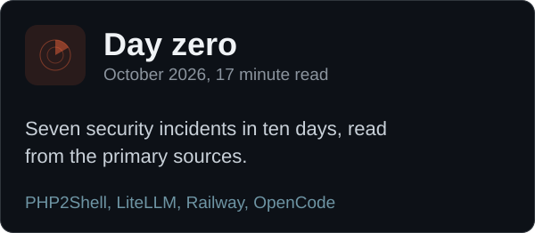</a>
  <a href="https://amansinghnp.com/writing/railway-breach"></a>

  <a href="https://amansinghnp.com/writing/php2shell"></a>
  <a href="https://amansinghnp.com/writing/canvas-breach"></a>

Also: <a href="https://github.com/AmanSinghNp/PhishGuard-AI">PhishGuard-AI</a>, a browser extension that flags phishing pages.

## Seismic systems

  <a href="https://github.com/AmanSinghNp/Basalt"></a>
  <a href="https://github.com/AmanSinghNp/fast-trigger"></a>

  <a href="https://github.com/AmanSinghNp/torch-friction"></a>
  <a href="https://github.com/AmanSinghNp/seismic-linter"></a>

Also: <a href="https://github.com/AmanSinghNp/nepal-earthquake-severity-prediction">Nepal severity model</a> · <a href="https://github.com/AmanSinghNp/global-seismic-analysis">global seismicity</a> · <a href="https://amansinghnp.com/writing/seismic-pytorch">the long report</a>

## Sandbox

  <a href="https://github.com/AmanSinghNp/Mini-JavaScript-Projects"></a>
  <a href="https://github.com/AmanSinghNp/SplitSmart-iOS"></a>

## Toolbelt

  

<a href="https://amansinghnp.com/writing">More writing at amansinghnp.com</a>

