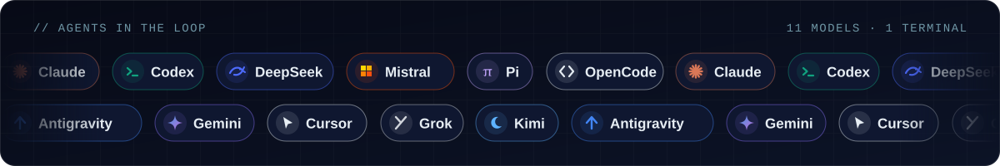
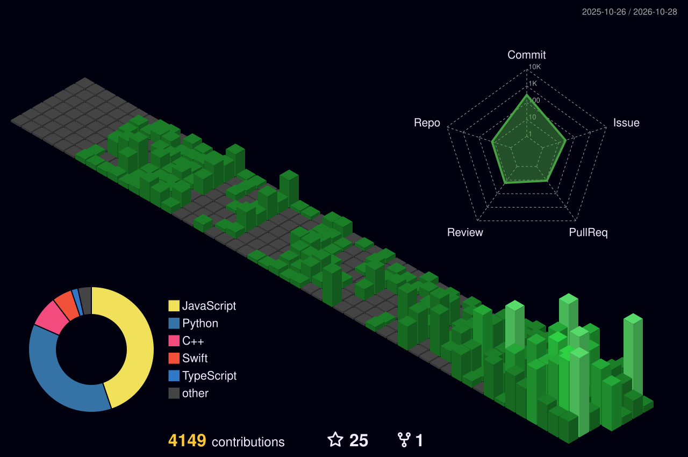

  
  
  
  

## Right now

I'm a founding engineer at [Gradstack](https://amansinghnp.com/projects/gradstack) in Sydney. We build verified skills profiles for early-career talent, plus GAFI, an index that measures how well people actually work with AI.

I graduated from UTS. While I was there, LiPi Sort, our handwritten postcode reader with a robot arm, won People's Choice at the Tech Fest 2026 AI Showcase.

Most of my public code is AI work or seismology tooling. I also write up security incidents, usually the week they happen.

## AI work

<table>
<tr>
<td width="50%" valign="top">

**LiPi Sort** 
YOLO11s fine-tuned on 1,310 postcards, 1,200 of them synthetic. It finds the handwritten postcode, reads it, looks up the suburb, and a robot arm sorts the card. People's Choice, UTS Tech Fest 2026. 
[Try it](https://huggingface.co/spaces/AmanSNP/postcard-yolo-app) · [Report](https://amansinghnp.com/writing/lipisort-deeplearning) · `PyTorch` `YOLO11` `EasyOCR`

</td>
<td width="50%" valign="top">

**Memora** 
A Slack agent that remembers what a team decided and says how sure it is. Built with teammates in three countries for the Slack Agent Builder Challenge. 
[Case study](https://amansinghnp.com/projects/memora) · [Write-up](https://amansinghnp.com/writing/memora-slack-agent) · `LLM agents` `Slack API`

</td>
</tr>
<tr>
<td width="50%" valign="top">

**[crowdcal](https://github.com/AmanSinghNp/crowdcal)** 
Does 70% mean 70% of people agree? Measures how well typed decision models are calibrated against the spread of human labels. 
`Python` `calibration` `evaluation`

</td>
<td width="50%" valign="top">

**Klarity** 
Students prove they understand a topic by teaching an AI that gets things wrong on purpose. Built at the EduX Hackathon 2026. 
[Case study](https://amansinghnp.com/projects/klarity) · `TypeScript` `LLMs`

</td>
</tr>
<tr>
<td width="50%" valign="top">

**[torch-friction](https://github.com/AmanSinghNp/torch-friction)** 
Differentiable rate-and-state friction layers for physics-informed neural networks. Fault slip physics you can backprop through. 
[Report](https://amansinghnp.com/writing/seismic-pytorch) · `PyTorch` `PINNs`

</td>
<td width="50%" valign="top">

**[PalmLab](https://github.com/AmanSinghNp/palmlab-gesture-playground)** 
Sculpt a 3D clay sphere with two hands in the browser. MediaPipe tracks the pinches and React Three Fiber deforms the mesh. 
[Live demo](https://amansinghnp.github.io/palmlab-gesture-playground/) · [Report](https://amansinghnp.com/projects/palmlab) · `MediaPipe` `R3F`

</td>
</tr>
<tr>
<td width="50%" valign="top">

**[ASL Interpreter](https://github.com/AmanSinghNp/ASL-Interpreter-AI)** 
A fingerspelling prototype. Hand landmarks become 42 numbers for a 24.5 KB TensorFlow Lite model. 
[Report](https://amansinghnp.com/projects/asl) · `OpenCV` `MediaPipe` `TFLite`

</td>
<td width="50%" valign="top">

**[seismic-linter](https://github.com/AmanSinghNp/seismic-linter)** 
A linter for seismic ML pipelines. It flags future data leaking into your training set before it inflates your forecast scores. On PyPI. 
`Python` `MLOps` `time series`

</td>
</tr>
</table>

## Security

I write incident breakdowns from primary sources: the timeline, what leaked, and what to patch or rotate first. Most come with interactive charts and a full reference list.

| Date | Write-up | Read |
|:--|:--|:--|
| Oct 2026 | [Day zero: seven incidents, ten days, and what AI changes](https://amansinghnp.com/writing/day-zero) PHP2Shell, GitLab, Node.js, QUIC, LiteLLM, Railway and OpenCode, plus a playbook. | 17 min |
| Oct 2026 | [The Railway breach explained: what leaked and what to rotate](https://amansinghnp.com/writing/railway-breach) Exposed environment variables, the AI-key campaign behind it, and the rotation order. | 10 min |
| Oct 2026 | [PHP2Shell: CVE-2026-109618 and CVE-2026-109619](https://amansinghnp.com/writing/php2shell) Two unauthenticated RCE flaws in PHP. What broke and what to patch first. 54 sources. | 13 min |
| May 2026 | [Inside the 2026 Canvas breach](https://amansinghnp.com/writing/canvas-breach) Our team's incident response plan for UTS Cybersecurity Tech Fest 2026, mapped to MITRE ATT&CK. | 11 min |

On the code side, [PhishGuard-AI](https://github.com/AmanSinghNp/PhishGuard-AI) is a browser extension that flags phishing pages.

## Systems and seismic

<table>
<tr>
<td width="50%" valign="top">

**[Basalt](https://github.com/AmanSinghNp/Basalt)** 
Bare-metal f-k noise attenuation for seismic data. Custom memory arenas, mmap I/O and x86-64 SIMD. 
`C++` `SIMD`

</td>
<td width="50%" valign="top">

**[fast-trigger](https://github.com/AmanSinghNp/fast-trigger)** 
STA/LTA earthquake event detection as a Python package, with the core in C++23, OpenMP for batches and pybind11 bindings. 
`C++23` `OpenMP` `Python`

</td>
</tr>
<tr>
<td width="50%" valign="top">

**[nepal-earthquake-severity-prediction](https://github.com/AmanSinghNp/nepal-earthquake-severity-prediction)** 
Predicts earthquake severity in Nepal from USGS data, with 100% recall on its 2024+ test set. 
Related: [South Asia Earthquake Severity](https://github.com/AmanSinghNp/South-Asia-Earthquake-Severity)

</td>
<td width="50%" valign="top">

**[global-seismic-analysis](https://github.com/AmanSinghNp/global-seismic-analysis)** 
23,409 M5.5+ earthquakes from 1965 to 2016. Sixteen of them released half the energy, and a depth classifier turned out to have memorised the map. 
[Report](https://amansinghnp.com/writing/global-seismicity)

</td>
</tr>
</table>

The four tools above, torch-friction and seismic-linter included, are covered in one long report: [Four tools for seismic data](https://amansinghnp.com/writing/seismic-pytorch).

## Sandbox

[Mini-JavaScript-Projects](https://github.com/AmanSinghNp/Mini-JavaScript-Projects) has 30 browser apps and 25 algorithm visualisers in plain, framework-free JavaScript. Highlights: a [Wolfenstein-style ray caster](https://amansinghnp.com/projects/raycaster), a [limit order book](https://amansinghnp.com/projects/pocket) that matches by price-time priority, Black-Scholes Greeks and a piece-table code editor.

[SplitSmart-iOS](https://github.com/AmanSinghNp/SplitSmart-iOS) splits bills in SwiftUI and reads receipts with VisionKit OCR.

## Writing

Everything lives at [amansinghnp.com/writing](https://amansinghnp.com/writing).

| Date | Post | Topic |
|:--|:--|:--|
| Oct 2026 | [Day zero: seven incidents, ten days, and what AI changes](https://amansinghnp.com/writing/day-zero) | Security, AI |
| Oct 2026 | [The Railway breach explained](https://amansinghnp.com/writing/railway-breach) | Security |
| Oct 2026 | [PHP2Shell: what we know about CVE-2026-109618 and CVE-2026-109619](https://amansinghnp.com/writing/php2shell) | Security |
| Jul 2026 | [Memora: a Slack agent for teams that forget](https://amansinghnp.com/writing/memora-slack-agent) | AI engineering |
| Jun 2026 | [Reading handwritten postcodes](https://amansinghnp.com/writing/lipisort-deeplearning) | Computer vision |
| May 2026 | [Inside the 2026 Canvas breach](https://amansinghnp.com/writing/canvas-breach) | Security |
| Apr 2026 | [The model had memorised the map](https://amansinghnp.com/writing/global-seismicity) | Data science |
| Mar 2026 | [Four tools for seismic data](https://amansinghnp.com/writing/seismic-pytorch) | Scientific computing |

## Toolbelt

  

## Contributions

<picture>
  <source media="(prefers-color-scheme: dark)" srcset="https://raw.githubusercontent.com/AmanSinghNp/AmanSinghNp/output/github-contribution-grid-snake-dark.svg" />
  
</picture>

